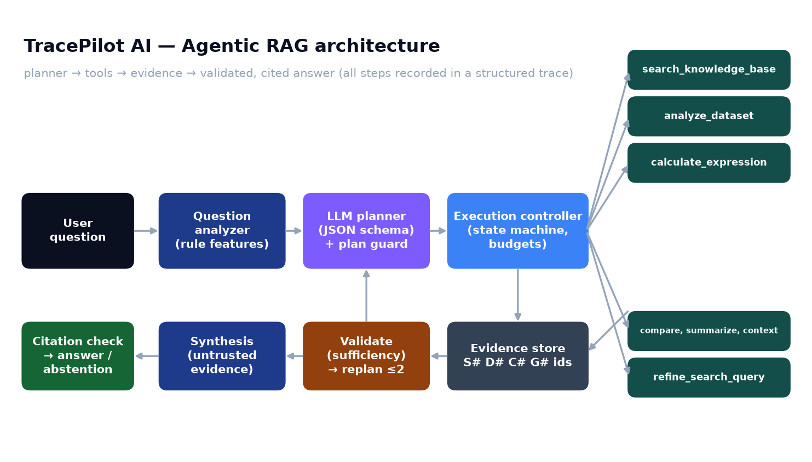
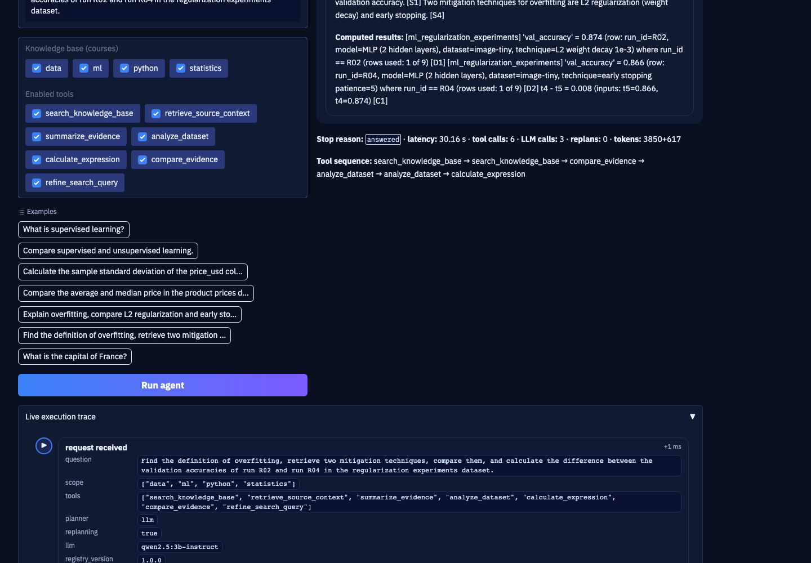
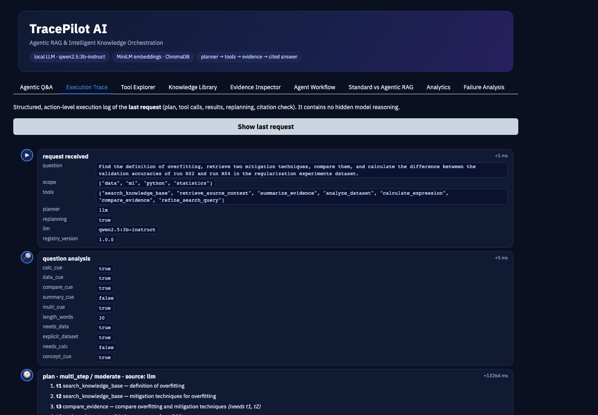
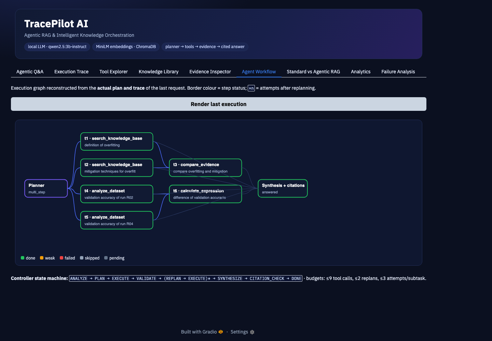
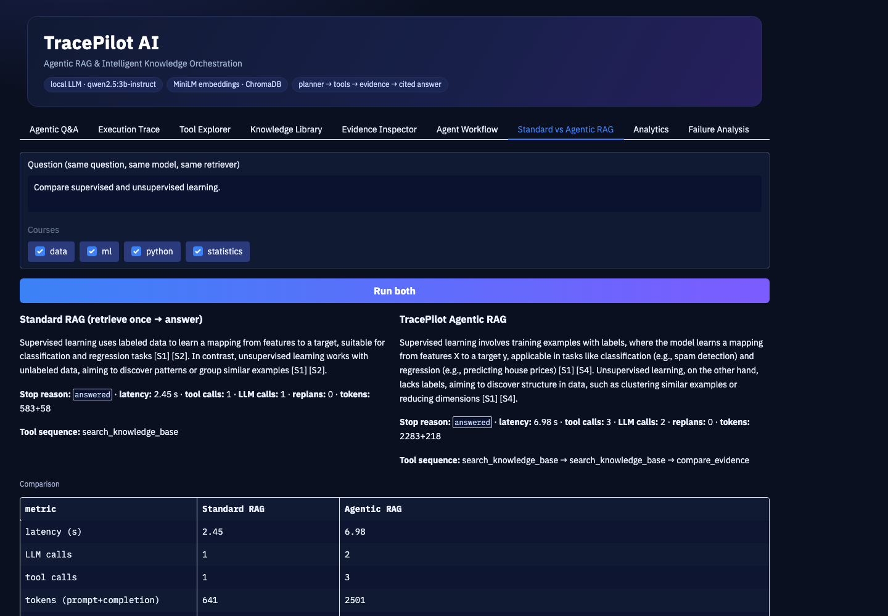
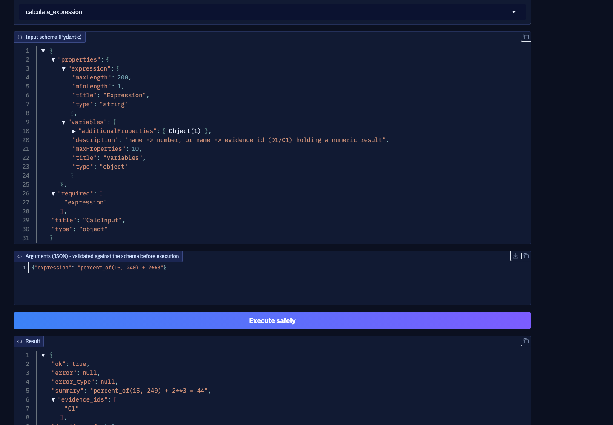
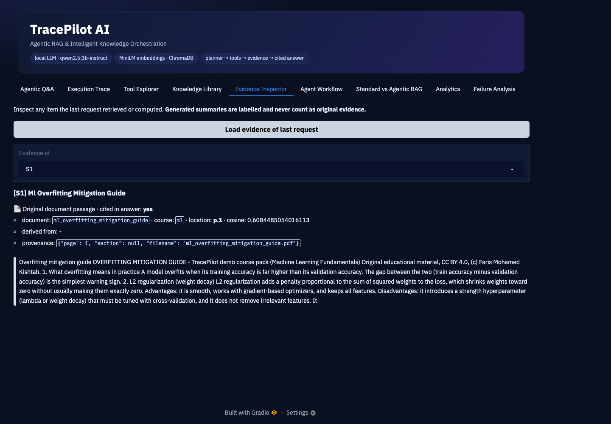
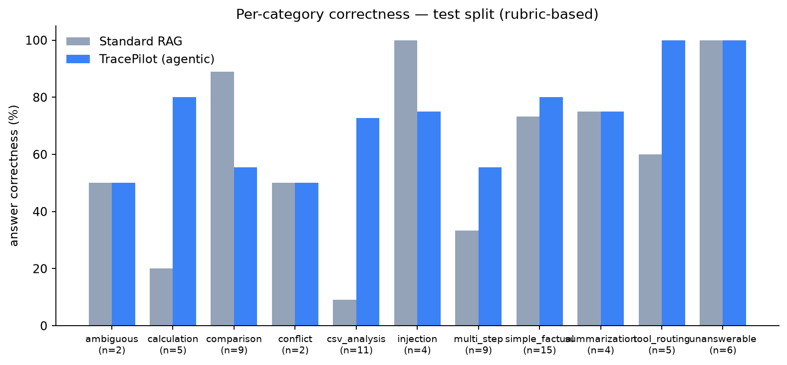

# TracePilot AI

**Agentic RAG & Intelligent Knowledge Orchestration Platform**

*Faris Mohamed Kishtah · INSTANT AI & Data Science Training · Sprint 4 — GANs & AI Agents · Project 4: Agentic RAG System*

A local, bounded **Agentic RAG** system. For every question TracePilot **plans** a typed sequence of tool calls, **executes** them under explicit budgets, **aggregates evidence** from document retrieval *and* deterministic computation (pandas, a safe calculator), **replans** (≤ 2 rounds) when evidence is weak or a tool fails, and answers with **verified citations** — or abstains.
It runs fully offline on an Apple M2 / 8 GB: Ollama (`qwen2.5:3b-instruct`) · all-MiniLM-L6-v2 · ChromaDB · Gradio. No paid API.

> **Honest summary.** On a frozen, held-out test split (72 questions; AI-assisted annotation, rubric scoring) TracePilot answered more questions correctly than a Standard-RAG baseline built on the same model and retriever, with the gain concentrated in questions that need computation. It was **not** better on comparison questions, and multi-step completion at answer level was not better than the baseline. Full tables, uncertainty and failures are below. Hugging Face hosting is blocked (HTTP 402); the project is local.



## What is new compared with CourseAtlas AI and ReGround AI

| | Standard RAG (CourseAtlas) | Corrective RAG (ReGround) | **Agentic RAG (TracePilot)** |
|---|---|---|---|
| control flow | fixed | fixed + correction loop | **per-question plan, conditional execution** |
| tools | – | – | search, source context, summarize, **dataset analysis, calculator**, compare, query refinement |
| numbers | quoted from text | quoted from text | **computed** with provenance (file hash, rows, filters) |
| failure handling | abstain | re-retrieve | repair arguments, re-search with new queries, add calculations, abstain |

ReGround AI's own evaluation did not statistically confirm an accuracy gain over Standard RAG; nothing here claims otherwise. The two earlier repositories were only read (documents copied under their CC BY 4.0 licence); they were not modified.

## Architecture and agent workflow

`question → analyzer (rule features) → LLM planner (JSON schema, Pydantic) → plan guard → execution controller → tools → evidence store (S#/D#/C#/G# ids) → validate → (replan ≤ 2) → synthesis → citation check → answer | abstention`

* **Planner** – typed `QuestionPlan` (type, complexity, `requires_*`, ≤ 8 subtasks with tools/arguments/dependencies). Invalid LLM output is never counted as success: retry with another seed, then a *visible* rule-based fallback.
* **Guard** – removes unknown/disabled tools, fixes dependency order, drops non-executable analysis steps, adds missing retrieval/comparison/summarization steps, requires an explicit dataset reference for `analyze_dataset`.
* **Controller** – explicit state machine; budgets: ≤ 9 tool calls, ≤ 2 replans, ≤ 3 attempts per subtask, ≤ 7 plan steps, 30 s per tool, 180 s per request. Every transition is traced.
* **Replanning** – re-search with a *different* query (synonyms → explanatory rephrase → specific keywords), argument repair (column/filter/lookup, multi-column split), added calculation (an LLM writes an expression from literal numbers/retrieved formulas; dry-run validated), retry on timeout.
* **Answer** – only sufficiently supported evidence reaches the LLM (as untrusted data); ids must exist; every cited sentence must be supported (numbers present in evidence, embedding similarity, word recall); computed values are appended deterministically; otherwise abstain.

Details: [ARCHITECTURE](docs/ARCHITECTURE.md) · [AGENT_DESIGN](docs/AGENT_DESIGN.md) · [TOOL_REGISTRY](docs/TOOL_REGISTRY.md) · [EXECUTION_WORKFLOW](docs/EXECUTION_WORKFLOW.md).

### Tool registry (v1.0.0, all read-only)

| tool | purpose |
|---|---|
| `search_knowledge_base` | dense (Chroma) + BM25 retrieval; scope can be narrowed, never widened |
| `retrieve_source_context` | neighbouring chunks of a retrieved source (same document, scope-checked) |
| `summarize_evidence` | validated bullets from chosen sources; generated items are never primary evidence |
| `analyze_dataset` | allow-listed pandas operations on CSVs (mean, median, std/var (sample by default), min, max, sum, count, group-by, correlation, filters, lookup …) |
| `calculate_expression` | AST-allow-listed arithmetic, statistics helpers, evidence-id variables; no `eval` |
| `compare_evidence` | extractive per-aspect comparison; conflicts and missing aspects preserved |
| `refine_search_query` | decomposition, normalisation, synonym expansion; numbers/ids/negations preserved |

## Knowledge base

35 documents (PDF, DOCX, CSV, TXT), 4 courses (Python, Statistics, Machine Learning, Data Wrangling), 167 chunks. 31 files are original CC BY 4.0 material by the author (CourseAtlas/ReGround), 4 were written for TracePilot (skewed product prices, regularization experiments, overfitting-mitigation guide, robust-summaries note). It deliberately contains superseded documents, overloaded terms and three prompt-injection lines. Upload, index, update, delete, reindex and inspect from the Studio. See [KNOWLEDGE_BASE](docs/KNOWLEDGE_BASE.md).

## TracePilot Studio (real screenshots)

| | |
|---|---|
|  |  |
| Multi-step question: answer, citations, live trace | Execution Trace (structured, action-level) |
|  |  |
| Executed workflow graph from the real trace | Standard vs Agentic on the same question |
|  |  |
| Tool Explorer (validated manual execution) | Evidence Inspector (provenance, original vs generated) |

More in [`artifacts/screenshots`](artifacts/screenshots): knowledge library, analytics, failure analysis, mobile layout (12 captured by Playwright from the running app; all displayed events come from real backend execution).

## Evaluation (frozen protocol)

114 questions (42 dev / 72 held-out test) in 11 categories with gold documents, required/forbidden tool capabilities, numeric gold computed by pandas and machine-verified evidence patterns. **Annotation is AI-assisted and not independently human-audited; scoring is keyword/number rubric based.** The protocol was frozen (SHA-256 + commit `eb6d241`) before any test run; the agent was tuned on dev only. Same LLM, retriever, prompt, validator and hardware for both systems. See [EVALUATION](docs/EVALUATION.md).

<!-- BEGIN:main -->
| metric (test split, n=72) | Standard RAG | TracePilot (agentic) |
|---|---|---|
| answer_correctness (all) | 42/72 (58.3%) | 53/72 (73.6%) |
| answer_correctness (answerable) | 36/66 (54.5%) | 47/66 (71.2%) |
| correct_abstention (unanswerable) | 6/6 (100.0%) | 6/6 (100.0%) |
| numerical_accuracy | 7/28 (25.0%) | 22/28 (78.6%) |
| multi_step_full_completion | 14/22 (63.6%) | 13/22 (59.1%) |
| mean latency (s) | 9.9 | 10.3 |
| p95 latency (s) | 29.9 | 24.7 |
| mean tool calls | 1.00 | 2.19 |
| false_abstention (answerable) | 8/66 (12.1%) | 6/66 (9.1%) |
| gold-document citation hit | 53/59 (89.8%) | 53/59 (89.8%) |
| mean LLM calls / tokens | 1.25 / 1296 | 2.25 / 2583 |

Paired difference in correctness: **+15.3 pp**, 95% paired-bootstrap CI **[+4.2, +26.4] pp** (TracePilot-only correct: 15, Standard-only correct: 4; interval excludes 0).
<!-- END:main -->

<!-- BEGIN:categories -->
| category | n | Standard RAG | TracePilot | paired diff (pp) |
|---|---|---|---|---|
| ambiguous | 2 | 1/2 | 1/2 | +0 |
| calculation | 5 | 1/5 | 4/5 | +60 |
| comparison | 9 | 8/9 | 5/9 | -33 |
| conflict | 2 | 1/2 | 1/2 | +0 |
| csv_analysis | 11 | 1/11 | 8/11 | +64 |
| injection | 4 | 4/4 | 3/4 | -25 |
| multi_step | 9 | 3/9 | 5/9 | +22 |
| simple_factual | 15 | 11/15 | 12/15 | +7 |
| summarization | 4 | 3/4 | 3/4 | +0 |
| tool_routing | 5 | 3/5 | 5/5 | +40 |
| unanswerable | 6 | 6/6 | 6/6 | +0 |
<!-- END:categories -->

<!-- BEGIN:planning -->
| planning / execution metric (test) | value |
|---|---|
| correct execution path | 69/72 (95.8%) |
| required-capability recall | 69/72 (95.8%) |
| mean tool precision | 0.901 |
| unnecessary-call rate | 15/158 (9.5%) |
| forbidden tool used | 0/72 (0.0%) |
| plan completion | 64/71 (90.1%) |
| requests that replanned | 17/72 (23.6%) |
| planner rule-fallback | 0/72 (0.0%) |
| multi-step full completion (answer-level) | Standard 14/22 (63.6%) → TracePilot 13/22 (59.1%) |
| latency mean / median / p95 (s) | Standard 9.9 / 6.6 / 29.9 → TracePilot 10.3 / 8.2 / 24.7 |
<!-- END:planning -->

Per-category counts are small (n ≤ 15): treat them as descriptive. The aggregate difference is the only inferential claim.



### Ablation (test split)

<!-- BEGIN:ablation -->
| system | n | correct | numeric | multi-step | mean latency (s) | tool calls |
|---|---|---|---|---|---|---|
| A  Standard RAG | 72 | 42/72 (58.3%) | 7/28 (25.0%) | 14/22 (63.6%) | 9.9 | 1.00 |
| B  LLM planner, retrieval tools only (no calc/data), no replan | 72 | 37/72 (51.4%) | 6/28 (21.4%) | 11/22 (50.0%) | 9.3 | 1.65 |
| C  rule planner, all tools, no replan | 72 | 38/72 (52.8%) | 12/28 (42.9%) | 9/22 (40.9%) | 4.7 | 1.53 |
| D/E  LLM planner, all tools, no replan | 72 | 51/72 (70.8%) | 20/28 (71.4%) | 12/22 (54.5%) | 9.0 | 1.92 |
| F  full: LLM planner + bounded replanning | 72 | 53/72 (73.6%) | 22/28 (78.6%) | 13/22 (59.1%) | 10.3 | 2.19 |

Paired bootstrap of (full − system) in correctness: vs standard: +15.3 pp, 95% CI [+4.2, +26.4]; vs llm_no_numeric_tools: +22.2 pp, 95% CI [+11.1, +33.3]; vs rules_all_tools: +20.8 pp, 95% CI [+11.1, +30.6]; vs llm_no_replan: +2.8 pp, 95% CI [+0.0, +6.9]. Experiments D and E coincide (an LLM planner without replanning); intervals that include zero mean the component's contribution is not confirmed on this benchmark.
<!-- END:ablation -->

Reading: the LLM planner and the numeric tools carry the improvement; retrieval-only agentic variants were *not* better than Standard RAG here; bounded replanning added a small gain whose interval touches zero (not confirmed). See [ABLATION_STUDY](docs/ABLATION_STUDY.md).

### Real failure cases
Silent wrong number from a dropped filter, a crash on a malformed plan, budget exhaustion after hallucinated filter values, comparison answers shortened by the faithfulness filter, false abstentions from truncated evidence — with traces — in [FAILURE_ANALYSIS](docs/FAILURE_ANALYSIS.md). Standard-vs-Agentic discussion: [BASELINE_COMPARISON](docs/BASELINE_COMPARISON.md).

## Testing

| suite | result |
|---|---|
| unit (pytest, no LLM): ingestion, retrieval, planning, tool routing/execution, agent state, citations, security, app | **103 passed, 0 failed, 0 skipped** |
| real-model integration (Ollama, 16 scenarios A–P) | **16 passed, 0 failed** |
| real browser (Playwright/Chromium, 15 UI checks incl. upload, live trace, mobile) | **1 test passed (15/15 checks)**, 12 screenshots |

The integration tests found a real bug (timeout retry ordering) that was fixed *after* the freeze; it did not affect any evaluated behaviour (0 timeouts in 288 test traces) — see [`data/evaluation/POST_FREEZE_CHANGES.md`](data/evaluation/POST_FREEZE_CHANGES.md).

## Install and run

```bash
python3.12 -m venv .venv && source .venv/bin/activate && pip install -r requirements.txt
ollama pull qwen2.5:3b-instruct          # or set TRACEPILOT_LLM_MODEL=qwen2.5:1.5b-instruct (Apache-2.0)
python scripts/build_index.py            # index data/documents
python app.py                            # http://127.0.0.1:7860
python -m pytest -m "not integration and not browser"
```

Reproduce the evaluation: [REPRODUCIBILITY](docs/REPRODUCIBILITY.md). Results live in `artifacts/metrics`, traces in `artifacts/execution_traces`.

## Security
Untrusted-by-default evidence, injection detection, no code/shell/file/network/SQL tools, AST-only calculator, enum-only dataset operations, path-safe storage, course isolation, budgets and timeouts. The controls prevent tool misuse; they cannot guarantee the prose of an LLM answer. [SECURITY](docs/SECURITY.md).

## Licensing
Code MIT. Documents and benchmark CC BY 4.0. `all-MiniLM-L6-v2` Apache-2.0. **`qwen2.5:3b-instruct` is under the Qwen Research License (non-commercial)**; the 1.5B model is Apache-2.0. PyMuPDF is AGPL-3.0. Models are not redistributed. [LICENSES](docs/LICENSES.md).

## Limitations
3B-model planning mistakes (partly repaired by guard/replanner), AI-assisted benchmark with keyword rubrics and a 35-document corpus, citation check is not NLI, ambiguous questions are not detected, multi-step latency of tens of seconds on an 8 GB M2, comparison questions worse than the baseline in this run, latency measured on a shared machine.

## Deployment
Local Gradio is the supported deployment. A live attempt to create a free Gradio Space returned **HTTP 402** (PRO required) for this account; nothing was created and no static placeholder was published. See [DEPLOYMENT](docs/DEPLOYMENT.md).
